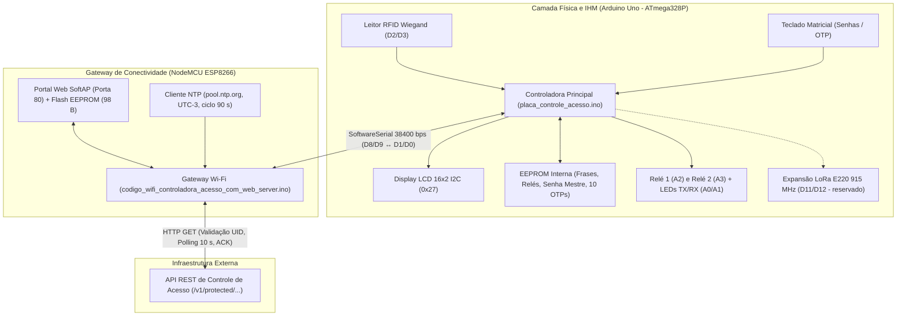
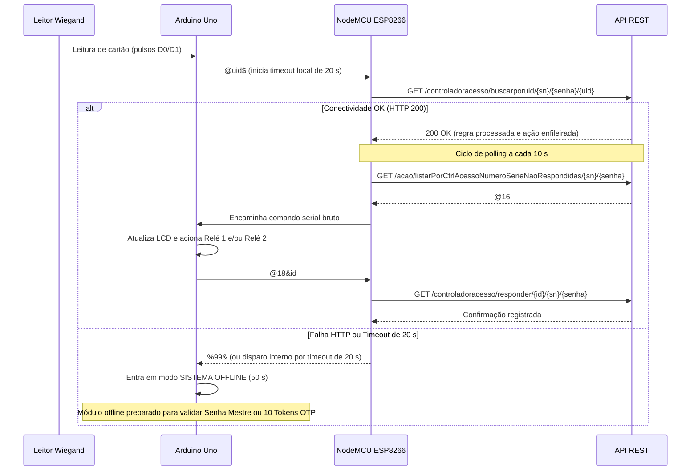

# Controlador de Acesso RFID com Arduino Uno e NodeMCU ESP8266

Sistema embarcado de controle de acesso físico com arquitetura distribuída em dois microcontroladores (Arduino Uno + NodeMCU ESP8266), projetado para leitura de credenciais RFID via protocolo industrial Wiegand, validação remota em API REST, acionamento independente de dois relés, provisionamento Wi-Fi por portal web embutido e camada de contingência offline em EEPROM com senha mestre e tokens numéricos de uso único (OTP).

[-1F3A5F?style=flat-square)](#hardware-e-mapeamento-de-pinos)

Desenvolvido no contexto da linha **TITANIWM**, o projeto separa rigidamente o plano determinístico de hardware — aquisição de pulsos Wiegand por interrupção externa, acionamento seguro de fechaduras/portões, persistência de parâmetros em EEPROM e interface homem-máquina local (LCD 16×2 I²C e teclado matricial) — do plano de conectividade em rede (SoftAP de configuração, sincronização NTP e consumo contínuo de API REST via HTTP).

**Demonstração funcional em vídeo:** [Assista à demonstração do Controlador de Acesso no YouTube](https://www.youtube.com/watch?v=nXhs9-V_dKY)

---

## Sumário

1. [Objetivo](#objetivo)
2. [Justificativa Técnica](#justificativa-técnica)
3. [Cenários de Uso](#cenários-de-uso)
4. [Arquitetura do Sistema](#arquitetura-do-sistema)
5. [Hardware e Mapeamento de Pinos](#hardware-e-mapeamento-de-pinos)
6. [Protocolo Serial Interno e Mapa EEPROM](#protocolo-serial-interno-e-mapa-eeprom)
7. [Gateway Wi-Fi e Integração com API REST](#gateway-wi-fi-e-integração-com-api-rest)
8. [Dependências e Estrutura do Repositório](#dependências-e-estrutura-do-repositório)
9. [Contato](#contato)
10. [Stack Técnica e Tecnologias Utilizadas](#stack-técnica-e-tecnologias-utilizadas)

---

## Objetivo

Projetar e implementar o firmware completo de uma controladora de acesso física conectada à nuvem, capaz de:

- Capturar identificadores de cartões e tags RFID por meio de leitores padrão **Wiegand** e encaminhá-los em hexadecimal para validação centralizada em API REST.
- Operar com **dois canais independentes de relé** com habilitação seletiva e temporizações configuráveis remotamente (`tempo base × multiplicador`), permitindo controlar fechaduras eletromagnéticas, travas solenoide ou acionadores de portão.
- Receber comandos assíncronos do servidor (liberação, bloqueio, abertura remota individual, atualização de mensagens no display, reconfiguração de tempos e troca de senha mestre) com **confirmação explícita de execução (ACK)**.
- Garantir continuidade operacional durante quedas de rede ou indisponibilidade do servidor por meio de detecção automática de estado offline (`%99&` ou timeout de `20 s`), persistência em **EEPROM** e mecanismo de validação local via **senha mestre** e **10 tokens numéricos OTP de uso único**.
- Simplificar a instalação em campo por meio de um **portal web embarcado** no NodeMCU ESP8266 (modo SoftAP + Flash EEPROM) para seleção e armazenamento das credenciais Wi-Fi sem necessidade de recompilação.

---

## Justificativa Técnica

Sistemas de controle de acesso instalados em portarias, empresas e áreas técnicas enfrentam dois desafios clássicos em hardware de baixo custo: **concorrência entre periféricos de tempo real e pilha TCP/IP** e **resiliência frente a falhas de internet**.

- **Separação física em dois microcontroladores (ATmega328P + ESP8266):** o protocolo Wiegand depende de interrupções externas precisas (`D0`/`D1`) em nível `5 V`, enquanto o teclado matricial, o display LCD 16×2 I²C, os LEDs de diagnóstico e os dois relés demandam elevada contagem de GPIOs estáveis no boot. Concentrar a camada de I/O e segurança no Arduino Uno e delegar HTTP, NTP e portal Wi-Fi ao NodeMCU ESP8266 evita bloqueios de watchdog durante requisições de rede lentas e elimina a limitação de pinos do ESP8266.
- **Lógica de relés *fail-safe* e proteção anti-reacionamento:** ambos os relés (`A2` e `A3`) operam em lógica ativa baixa (`LOW`) e são inicializados em `HIGH` no `setup()`, prevenindo abertura indevida de portas durante reinicializações. Acionamentos individuais remotos (`tipo 33`) incluem janela de bloqueio (`cooldown`) de `10 s` contra comandos duplicados.
- **Ciclo de confirmação ponta a ponta (ACK):** em vez de depender de disparos *fire-and-forget*, cada ação baixada da fila REST carrega um `id_requisicao` único que o Arduino devolve ao ESP8266 após concluir a rotina local, garantindo rastreabilidade e baixa definitiva da tarefa na API.
- **Tokens OTP autoapagáveis em EEPROM:** a tabela de 10 tokens numéricos de 16 bits (`endereços 400–419`) zera imediatamente o slot na EEPROM assim que uma senha é consumida (`compareSenha()`), permitindo conceder acessos emergenciais únicos sem internet e sem reutilização posterior da mesma credencial.
- **Base preparada para telemetria com central de alarme via LoRa:** o firmware do controlador já reserva interface dedicada (`D11`/`D12`) para módulo `LoRa E220 (915 MHz)`, possibilitando integração futura de desarme/rearme de alarme e alerta de acesso negado.

---

## Cenários de Uso

- **Portarias corporativas, indústrias e escritórios:** autenticação de colaboradores por cartão RFID Wiegand com validação centralizada de horários, permissões e registro de auditoria na API.
- **Condomínios e acessos com dupla barreira (eclusa ou portão + porta social):** utilização coordenada dos dois canais de relé (`pinoRele1` e `pinoRele2`) com tempos independentes configuráveis remotamente conforme a característica mecânica de cada fechadura.
- **Salas técnicas, datacenters e almoxarifados de acesso restrito:** liberação remota individual de fechaduras pela central de monitoramento (`tipo 33`), manutenção da data/hora sincronizada via NTP no display local e sinalização imediata de acesso negado.
- **Ambientes com conectividade instável:** operação assistida com exibição de mensagem customizada de contingência (`SISTEMA OFFLINE`) e suporte arquitetural a liberação local por senha mestre ou tokens OTP de uso único gravados em EEPROM.

---

## Arquitetura do Sistema

O sistema divide as responsabilidades entre a **Controladora Física** (`placa_controle_acesso.ino`) e o **Gateway Wi-Fi / Web Server** (`codigo_wifi_controladora_acesso_com_web_server.ino`), interligados por um enlace serial assíncrono dedicado a `38400 bps` com protocolo próprio baseado em delimitadores ASCII.

### Ciclo de Validação Online, Polling de Ações e Contingência Offline

---

## Hardware e Mapeamento de Pinos

### Controladora Física — Arduino Uno (`placa_controle_acesso.ino`)

| Pino | Sinal / Periférico | Direção | Detalhes de Operação |
| :--- | :--- | :--- | :--- |
| `D2` (`INT0`), `D3` (`INT1`) | Leitor RFID Wiegand (`D0`, `D1`) | Entrada | Interrupções externas padrão da biblioteca `Wiegand.h` |
| `A4` (`SDA`), `A5` (`SCL`) | Display LCD 16×2 I²C (`PCF8574`) | Bidirecional | Endereço `0x27`, inicializado via `LiquidCrystal_I2C` |
| `D5`, `D4`, `D10` | Teclado Matricial — Linhas (`rowPins`) | I/O | Varredura via `Keypad.h` (matriz `3×3` `'1'..'9'` no sketch atual; expansível para `4×4`) |
| `D6`, `D7`, `D13` | Teclado Matricial — Colunas (`colPins`) | I/O | Entrada de senhas e tokens numéricos de 4 dígitos |
| `A2` | `pinoRele1` (Fechadura / Portão 1) | Saída | Ativo em `LOW`; inicia em `HIGH` (*fail-safe*), duração `tempo × multiplicador` |
| `A3` | `pinoRele2` (Fechadura / Portão 2) | Saída | Ativo em `LOW`; inicia em `HIGH` (*fail-safe*), duração `tempo × multiplicador` |
| `A0` | `pinoLedTx` | Saída | Indicador luminoso de transmissão / inicialização |
| `A1` | `pinoLedRx` | Saída | Indicador luminoso de recepção / acionamento remoto de relé |
| `D8` (`RX`), `D9` (`TX`) | `SoftwareSerial wifi` → ESP8266 | UART | `38400 bps`, enlace cruzado (`TX ↔ RX`) com o NodeMCU |
| `D11` (`RX`), `D12` (`TX`) | `rxPinLora`, `txPinLora` (Reservado) | UART | Pinos previstos para módulo rádio `LoRa E220` (`915 MHz`) |

### Gateway de Rede — NodeMCU ESP8266 (`codigo_wifi_controladora_acesso_com_web_server.ino`)

| Pino | Sinal / Periférico | Direção | Detalhes de Operação |
| :--- | :--- | :--- | :--- |
| `D1` (`GPIO5` — `RX`) | `SoftwareSerial mySerial` ← Arduino `D9` | Entrada UART | `38400 bps`; recomenda-se divisor resistivo ou conversor `5 V → 3,3 V` |
| `D0` (`GPIO16` — `TX`) | `SoftwareSerial mySerial` → Arduino `D8` | Saída UART | `38400 bps`; envia comandos da API e pacotes NTP |
| `LED_BUILTIN` | LED de *Heartbeat* | Saída | Alterna estado a cada `1000 ms` indicando execução do laço principal |
| `TX0` / `RX0` (USB) | Console de depuração | UART | `115200 bps` para logs de conexão Wi-Fi, HTTP e tráfego serial |

> [!WARNING]
> **Compatibilidade de níveis lógicos (`5 V` vs. `3,3 V`):** o pino `D9` (`TX`) do Arduino Uno opera em `5 V`, enquanto o pino `D1` (`GPIO5`) do NodeMCU ESP8266 opera nominalmente em `3,3 V`. Em montagens definitivas, utilize um conversor de nível lógico bidirecional ou divisor resistivo na linha `Arduino TX → ESP8266 RX` e mantenha referência `GND` comum entre as placas.

---

## Protocolo Serial Interno e Mapa EEPROM

A comunicação entre o Arduino Uno e o NodeMCU ESP8266 utiliza quadros ASCII delimitados por caracteres de controle sobre `SoftwareSerial` a **`38400 bps`**, permitindo decodificação leve sem dependência de parsers JSON no ATmega328P.

### Quadros de Comando e Resposta

| Direção | Formato do Quadro | Código | Função Executada | Resposta / ACK |
| :--- | :--- | :--- | :--- | :--- |
| `Arduino → ESP8266` | `@<uid>$` | — | Envia UID hexadecimal lido do cartão RFID para consulta na API | Dispara `GET buscarporuid`; retorna `%99&` em erro |
| `Arduino → ESP8266` | `@<tipo>&<id>#` | `17`, `18`, `19`, `34`, `71` | Confirma execução local de uma ação recebida da fila | ESP8266 chama `GET responder/{id}` |
| `ESP8266 → Arduino` | `@16#<id>$` | `16` | **Acesso Liberado:** exibe mensagem no LCD e aciona Relé 1 e/ou Relé 2 de forma coordenada | `@18&<id>#` |
| `ESP8266 → Arduino` | `@17#<id>$` | `17` | **Acesso Negado:** exibe bloqueio no LCD por `3 s` (e sinalização opcional de alarme) | `@19&<id>#` |
| `ESP8266 → Arduino` | `&33+<rele>#<id>$` | `33` | **Acionamento Remoto Individual** do Relé `1` ou `2` com proteção *cooldown* de `10 s` | `@34&<id>#` |
| `ESP8266 → Arduino` | `%99&` | `99` | **Falha de Conectividade:** ativa modo `SISTEMA OFFLINE` no LCD por `50 s` | — |
| `ESP8266 → Arduino` | `*<data> <hora>}` | — | **Sincronização NTP:** atualiza `dataHoraGlobal` exibida no display (a cada `90 s`) | — |
| `ESP8266 → Arduino` | `A40@<d>-<r1>*<t1>#<m1>Y<r2>+<t2>Z<m2>%<id>$` | `40` | **Reconfiguração Remota:** atualiza flags e tempos dos relés na EEPROM e recarrega parâmetros | `@17&<id>#` |
| `ESP8266 → Arduino` | `K80A<msg>B<id>$` | `80` | **Mensagem Online:** persiste frase exibida no display em operação normal (`EEPROM 0`) | `@17&<id>#` |
| `ESP8266 → Arduino` | `K81A<msg>B<id>$` | `81` | **Mensagem Offline:** persiste frase exibida no display em contingência (`EEPROM 200`) | `@17&<id>#` |
| `ESP8266 → Arduino` | `K82A<senha>B<id>$` | `82` | **Senha Mestre:** atualiza senha numérica de 16 bits na EEPROM (`endereços 307–308`) | `@17&<id>#` |
| `ESP8266 → Arduino` | `W70A<t0>B..J<t9>K<id>$` | `70` | **Lote de 10 Tokens OTP** (bloco previsto no código, comentado no sketch atual) | `@71&<id>#` |

### Mapa de Memória Não Volátil (EEPROM)

#### Arduino Uno (`ATmega328P`)

| Endereço | Tamanho | Conteúdo Persistido | Regra de Codificação / Uso |
| :--- | :--- | :--- | :--- |
| `0` | Variável | Frase da linha 1 (modo online) | String terminada em caractere nulo (`salvarInformacao` / `carregarInformacao`) |
| `200` | Variável | Frase da linha 1 (modo offline) | Exibida em rolagem horizontal durante o estado `SISTEMA OFFLINE` |
| `300` | 1 byte | `disparar_acesso_negado` | Flag de disparo de alerta em caso de acesso negado |
| `301` | 1 byte | `acionar_rele1_liberado` | Habilita (`1`) ou inibe (`0`) o Relé 1 ao liberar acesso |
| `302` | 1 byte | `acionar_rele2_liberado` | Habilita (`1`) ou inibe (`0`) o Relé 2 ao liberar acesso |
| `303` – `304` | 2 bytes | Base e multiplicador do Relé 1 | Duração efetiva calculada como `EEPROM[303] × EEPROM[304]` |
| `305` – `306` | 2 bytes | Base e multiplicador do Relé 2 | Duração efetiva calculada como `EEPROM[305] × EEPROM[306]` |
| `307` – `308` | 2 bytes | `senha_master` (16 bits) | Big-endian (`senha / 256`, `senha % 256`), validada em `compareSenhaMestre()` |
| `400` – `419` | 20 bytes | `tokens_globais[10]` (10 × 16 bits) | Tokens OTP de uso único; `compareSenha()` grava `0x0000` no slot imediatamente após validação |

#### NodeMCU ESP8266 (Flash EEPROM — `98 bytes`)

| Endereço | Conteúdo | Descrição |
| :--- | :--- | :--- |
| `0` | `ssidLen` | Comprimento em bytes do SSID da rede Wi-Fi |
| `1` | `passLen` | Comprimento em bytes da senha Wi-Fi |
| `2 .. 2 + ssidLen - 1` | `SSID` | Caracteres ASCII do SSID salvo pelo portal web |
| `2 + ssidLen .. fim` | `Password` | Caracteres ASCII da senha Wi-Fi salva pelo portal web |

---

## Gateway Wi-Fi e Integração com API REST

O firmware do NodeMCU ESP8266 combina simultaneamente **Access Point de configuração local** e **cliente Station HTTP/NTP**, facilitando comissionamento e manutenção em campo:

1. **Portal Web de Provisionamento (`ESP8266WebServer` porta `80`):**
   - Publica a rede SoftAP (`TITANIWM CTRLACESS <S/N>`) na inicialização e tenta reconectar automaticamente às credenciais já gravadas na Flash EEPROM (`connectEeprom()`).
   - `GET /`: executa varredura de redes Wi-Fi (`WiFi.scanNetworks()`) e exibe formulário HTML para seleção do SSID e inserção da senha.
   - `GET/POST /action_new_connection`: conecta à nova rede informada e grava SSID e senha nos `98 bytes` de EEPROM.
   - `GET /action_previous_connection`: força reconexão utilizando as credenciais previamente persistidas.
2. **Sincronização Temporal via NTP:**
   - Consulta `pool.ntp.org` com deslocamento de `-10800 s` (`UTC-3`, horário de Brasília) usando `NTPClient` e envia o quadro `*<data> <hora>}` ao Arduino na inicialização e a cada **`90 s`**.
3. **Endpoints REST Consumidos (`ESP8266HTTPClient`):**

| Operação | Endpoint (`GET {BASE_URL}/...`) | Periodicidade / Gatilho |
| :--- | :--- | :--- |
| Validação de cartão RFID | `v1/protected/controladoracesso/buscarporuid/{numero_serie}/{senha}/{uid}` | Sob demanda ao receber `@<uid>$` do Arduino |
| Busca de ações pendentes | `v1/protected/acao/listarPorCtrlAcessoNumeroSerieNaoRespondidas/{numero_serie}/{senha}` | Polling periódico a cada `10 s` |
| Confirmação de ação (ACK) | `v1/protected/controladoracesso/responder/{id}/{numero_serie}/{senha}` | Sob demanda ao receber `@<tipo>&<id>#` do Arduino |
| Teste de conectividade | `v1/protected/controladoracesso/teste` | Auxiliar (`testarConexao()`) |
| Rotas auxiliares mapeadas | `transmissores/informarOnline/`, `acao/registrarzonadisparada/`, `acao/informarstatuscentral/` | Declaradas no cabeçalho para telemetria complementar |

> [!IMPORTANT]
> **Segurança e comissionamento:** antes de gravar o firmware do ESP8266 em ambiente produtivo, substitua `BASE_URL`, `numero_serie_local`, `senha` da API e credenciais do SoftAP por parâmetros próprios do seu servidor, preferencialmente isolados em um arquivo de configuração não versionado (`secrets.h`), e utilize transporte HTTPS/TLS sempre que suportado pela infraestrutura.

---

## Dependências e Estrutura do Repositório

### Bibliotecas Necessárias (Arduino IDE / PlatformIO)

- **Controladora (`placa_controle_acesso.ino` — Arduino Uno):**
  - `Wiegand` (`Wiegand.h`)
  - `Keypad` (`Keypad.h`)
  - `LiquidCrystal_I2C` (`LiquidCrystal_I2C.h`)
  - `SoftwareSerial`, `Wire`, `EEPROM` (nativas do core AVR)
  - `MemoryFree` (`MemoryFree.h`, diagnóstico de RAM)
  - `LoRa_E220` *(opcional, comentada para expansão LoRa 915 MHz)*
- **Gateway (`codigo_wifi_controladora_acesso_com_web_server.ino` — NodeMCU ESP8266):**
  - `ESP8266WiFi`, `ESP8266WebServer`, `ESP8266HTTPClient`, `WiFiClient`, `WiFiUdp`, `EEPROM` (core ESP8266)
  - `SoftwareSerial` (`EspSoftwareSerial`)
  - `NTPClient` (`NTPClient.h`)

> [!NOTE]
> **Módulos ativos e recursos opcionais no sketch do Arduino:** no estado atual do `loop()` em `placa_controle_acesso.ino`, o fluxo principal de leitura RFID Wiegand, envio de UID ao ESP8266, recepção de comandos remotos (`16`, `17`, `33`, `40`, `80`, `81`, `82`, `99`, NTP) e detecção de timeout offline (`20 s`) está ativo. Os blocos complementares de rolagem contínua do LCD, entrada local por teclado com validação de senha mestre/tokens OTP offline (`compareSenha()` / `compareSenhaMestre()`), gravação remota de tokens (`tipo 70`) e envio via LoRa E220 permanecem implementados no mesmo arquivo e comentados para habilitação conforme o perfil de instalação.

### Estrutura de Arquivos

| Arquivo | Função |
| :--- | :--- |
| [placa_controle_acesso.ino](./placa_controle_acesso.ino) | Firmware do Arduino Uno: leitura RFID Wiegand, controle dos 2 relés, protocolo serial, persistência EEPROM, IHM LCD/teclado e lógica de contingência offline |
| [codigo_wifi_controladora_acesso_com_web_server.ino](./codigo_wifi_controladora_acesso_com_web_server.ino) | Firmware do NodeMCU ESP8266: portal web SoftAP de configuração Wi-Fi, cliente NTP, polling HTTP REST e ponte serial com o Arduino |
| [README.md](./README.md) | Documentação técnica, arquitetura, mapeamento de hardware e protocolo de comunicação |

---

## Contato

- **Autor:** Aislan Silva Costa
- **E-mail:** [comprasaislan@gmail.com](mailto:comprasaislan@gmail.com)
- **LinkedIn:** [linkedin.com/in/aislan-silva-costa-660814341](https://www.linkedin.com/in/aislan-silva-costa-660814341/)

---

## Stack Técnica e Tecnologias Utilizadas

| Categoria | Itens |
| :--- | :--- |
| **Hardware** | `Arduino Uno (ATmega328P)` `NodeMCU ESP8266` `Leitor RFID Wiegand` `Display LCD 16x2 I2C (PCF8574)` `Teclado Matricial` `Módulo 2 Relés` `EEPROM Interna / Flash` `LoRa E220 915 MHz (expansão)` |
| **Protocolos** | `Wiegand` `UART (SoftwareSerial 38400 bps)` `I2C` `Wi-Fi (STA + SoftAP)` `HTTP` `REST` `NTP (UDP)` `LoRa (expansão)` |
| **Tecnologias** | `C++ (Arduino)` `ESP8266WebServer` `ESP8266HTTPClient` `NTPClient` `LiquidCrystal_I2C` `Wiegand.h` `Keypad.h` `EEPROM` `HTML Embarcado` `OTP Offline` |
